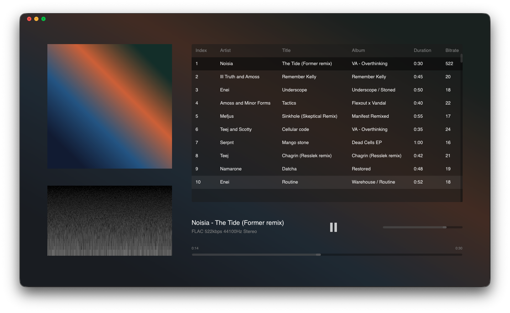

# Skald

Skald is a small desktop music player in the spirit of Foobar2000: a blurred
album-art backdrop, one flat track list, and no playlist tabs. It plays FLAC,
WAV and MP3, reads embedded cover art, draws a live spectrogram, and keeps its
state in `~/.config/skald`.

Built with Rust and [GPUI](https://gpui.rs), and runs on macOS and Ubuntu 24.04.



## Features

- Album art sidebar with a live, scrolling spectrogram beneath it.
- One track list with index, artist, title, album, duration and bitrate.
- Double-click or Enter plays; Space pauses; playback advances to the next track.
- Multi-select rows (`Shift` / `Cmd` on macOS, `Ctrl` on Linux), delete removes
  them from the playlist without touching the files on disk.
- Five-band equalizer (±6 dB) with a smooth response curve.
- Theme follows the current cover: dark covers get the dark palette, light
  covers get the light one.
- Custom window controls: close, minimize and maximize in the top strip, which
  also drags the window.
- Window position, volume, EQ gains, playlist and playback position survive a
  restart.

## Installation

The quickest route is the install script. It downloads the newest release for
your machine, verifies its SHA-256 and drops the binary into `~/.local/bin`:

```console
$ curl -LsSf https://raw.githubusercontent.com/manti-by/skald/master/install.sh | sh
```

For building from source and the other installation options, see
[INSTALL.md](wiki/docs/INSTALL.md).

## Usage

Open a folder with `Cmd+O` (**File → Add Folder…**), or pick individual files
with `Cmd+Shift+O` (**File → Add Files…**). Double-click a row or press `Enter`
to play it, `Space` to pause, and `Delete` to take the selection out of the
playlist. The equalizer lives under **View → Equalizer…** (`Cmd+E`).

The complete shortcut table, supported formats and the on-disk state format are
in [MORE.md](wiki/docs/MORE.md).
